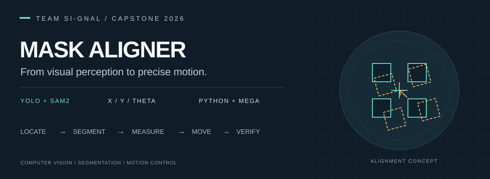
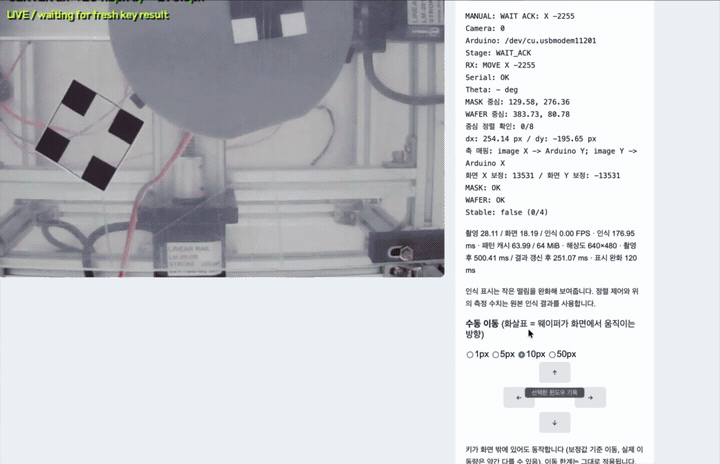
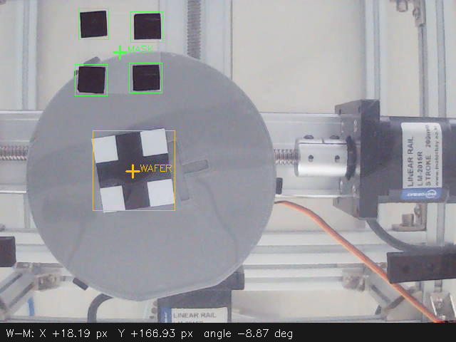
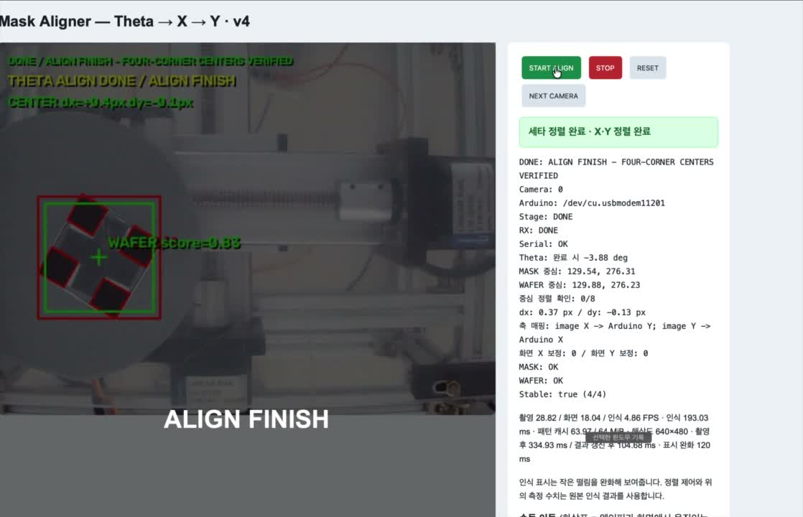
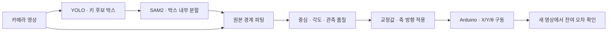
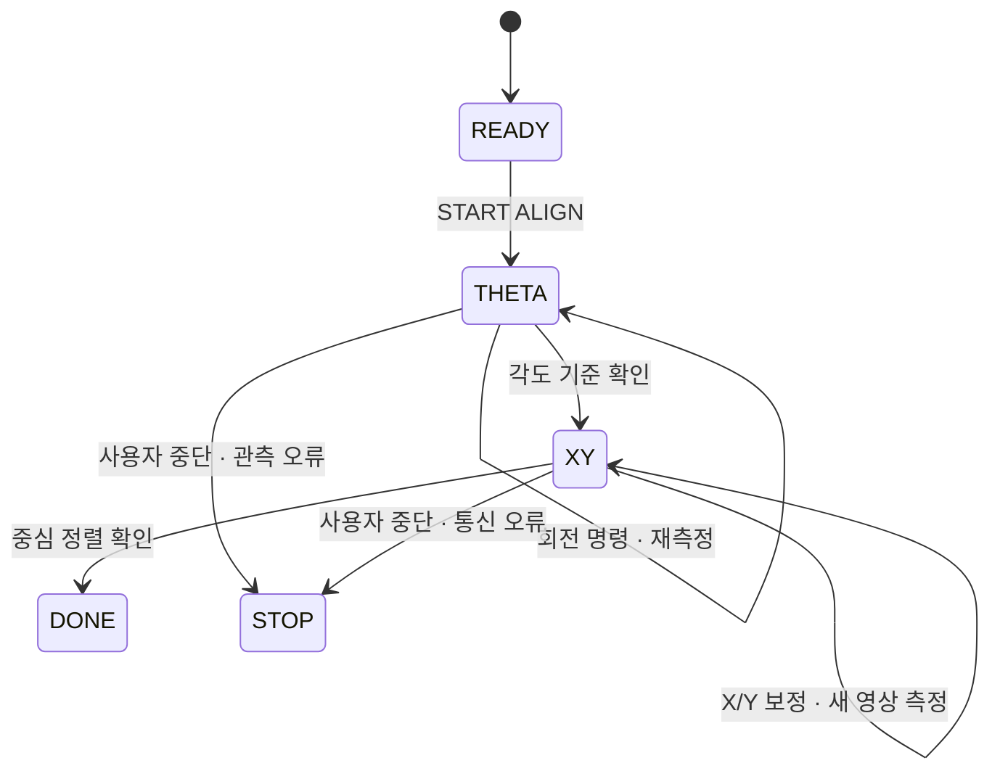

<div align="center">



# Vision-guided Mask Alignment

**YOLO + SAM2 기반 키 인식과 X/Y/θ 스테이지 제어를 연결하는 비전 정렬 프로젝트**

Lab-Linked 캡스톤 디자인 · Team Si-gnal · 2026

[프로젝트](#프로젝트-소개) · [시연](#실제-장비와-인식-화면) · [AI 파이프라인](#yolo--sam2-파이프라인) · [실험 결과](#실험-결과) · [실행 가이드](docs/team-guide.md)

</div>

## 프로젝트 소개

마스크 얼라이너는 **고정된 마스크의 기준 표식에 웨이퍼의 표식을 맞추는 장비**입니다. 이 프로젝트는 카메라로 두 표식의 위치와 방향을 측정하고, 그 차이를 모터 명령으로 바꾸어 웨이퍼 스테이지를 정렬합니다.

우리가 다루는 범위는 **촬영 → 키 인식 → 정밀 좌표 측정 → 교정값 적용 → 모터 제어 → 결과 확인**입니다. 이미지 인식 모델을 실제 기계의 동작과 연결하고, 같은 실험을 다시 확인할 수 있도록 좌표·상태·통신 기록을 남깁니다.

| 구성 | 역할 |
|---|---|
| **YOLO + SAM2** | 키의 후보 위치를 찾고 해당 영역을 분할하는 AI 검출 경로 |
| **원본 영상의 기하 측정** | 사각형 경계·십자 중심선으로 중심과 각도를 계산 |
| **Python 제어 앱** | 카메라, 좌표 변환, 정렬 상태 머신, 웹 화면, 시리얼 통신 |
| **Arduino Mega + TB6560** | 정해진 펄스 수와 방향으로 X/Y 스테이지 구동 |
| **θ 서보** | D30 신호로 회전 보정 후 영상에서 응답 확인 |

> **현재 확인한 범위** — YOLO+SAM2 코드와 별도 SW 실험의 실제 카메라 인식 기록을 갖추었습니다. 이 저장소의 기본 실행 및 10월 12일 실장비 정렬 기록은 **OpenCV + 서브픽셀 측정 경로**입니다. AI 인식 결과와 기계 구동 결과를 각각 표시하며, 아래 실장비 수치를 YOLO+SAM2의 정렬 성능으로 해석하지 않습니다.

## 실제 장비와 인식 화면

[](docs/media/alignment-demo.mp4)

**[▶ 전체 시연 영상 보기 · 74초](docs/media/alignment-demo.mp4)** · 위 미리보기는 원본 12–70초 구간의 4배속입니다.

시연은 **θ 회전 보정 → X/Y 위치 보정 → ALIGN FINISH** 순서로 진행됩니다. 제공 영상의 실행 모델·가중치 메타데이터는 없으므로 모델 성능 수치는 별도 실험 기록을 기준으로 소개합니다.


<table>
<tr>
<td width="50%"></td>
<td width="50%"></td>
</tr>
<tr>
<td><b>AI 인식 실험 · 2026-10-02</b><br/>별도 SW 실험 코드의 YOLO26n → SAM2 → 원본 경계 측정. 이 실행은 관찰 전용으로 모터를 움직이지 않았습니다.</td>
<td><b>제공 영상의 완료 화면 · 68초 지점</b><br/>θ → X/Y 보정을 마친 화면입니다. 왼쪽 인식 실험과 다른 실행이며, 아래 10월 12일 수치의 전후 비교 사진이 아닙니다.</td>
</tr>
</table>

검은 사각형 네 개는 **마스크 키**, 웨이퍼의 십자와 흰 창 구조는 **움직일 기준 표식**입니다. 최종 목표는 두 기준의 위치와 방향을 일치시키는 것입니다. 중심이 같더라도 회전·크기 차이가 남으면 패턴 전체가 일치하지 않을 수 있습니다.

## YOLO + SAM2 파이프라인



### 1. YOLO — 어디에 어떤 키가 있는가

키의 위치와 종류를 박스로 찾습니다. 마스크 사각형과 웨이퍼 키를 구분하도록 학습한 가중치가 필요합니다. 범용 가중치만으로 이 장비의 정렬 표식을 인식한다고 가정하지 않습니다.

별도 SW 초기 실험은 **YOLO26n**, 클래스 `mask_square` / `wafer_key`로 구성했습니다. 실제 사진 9장 중 학습 7장, 검증·시험 각 1장으로 추론 연결을 확인했습니다. 두 장면의 유사 프레임이 포함되어 있어 일반화 성능이나 정밀도를 입증하는 데이터셋은 아닙니다. [학습 구성과 출처](docs/evidence/yolo-trial-manifest.json)

### 2. SAM2 — 후보 안에서 어떤 픽셀이 키에 속하는가

**SAM 2.1 Hiera Small**에 YOLO 박스를 프롬프트로 주어 후보 영역을 분할합니다. 현재 실험에서는 사전 학습된 SAM2를 사용하며 별도의 SAM2 미세조정은 하지 않았습니다. SAM2의 분할 마스크는 물리적인 마스크 부품과 다른, 픽셀 단위 영역 정보입니다.

### 3. 기하 측정 — 정렬에 쓸 기준 중심은 어디인가

YOLO 박스와 SAM2 영역을 이용해 원본 영상에서 측정할 경계를 선택합니다. 마스크는 네 사각형의 기하 배치, 웨이퍼는 십자 팔의 중심선을 이용합니다. 서브픽셀 측정은 경계 주변의 밝기 기울기를 보간하고 직선을 맞춰 기준 중심을 계산합니다.

**분할 점수가 높다는 것과 중심 좌표가 정확하다는 것은 별개입니다.** 검출 점수, 좌표 오차, 경계 관측 품질, 처리 시간을 구분해서 평가합니다.

<details>
<summary><b>이 저장소와 별도 SW 실험의 구현 범위</b></summary>

| 항목 | 팀 저장소의 현재 구현 | 별도 SW 실험 기록 |
|---|---|---|
| YOLO 사용 | `sam2_keys.py`에서 클래스 0의 사각형 박스 사용 | 마스크 사각형 4개 + 웨이퍼 키 1개를 검출 |
| SAM2 사용 | 사각형 박스를 분할해 사각형 후보를 정제 | 두 키 종류의 박스를 분할 |
| 웨이퍼 측정 | 기존 십자 탐색 + `PreciseKeys` 기하 측정 | 십자 중심선 또는 흰 창의 원본 경계 측정 |
| 정렬 실행 | θ → X/Y, 새 영상으로 반복 보정 | 이동 전 한 계획 → X/Y 실행 → 별도 후평가 |
| 이동 후 평가 | 정렬 루프의 새 영상 측정과 완료 판정 | YOLO + 원본 경계 측정, 추가 이동 없음 |

별도 실험의 코드 전체가 이 저장소에 통합된 것은 아닙니다. 인식 결과 JSON과 학습 manifest를 문서 근거로 제공합니다. 이 저장소에서 실행 가능한 옵션은 [AI 실험 가이드](docs/model-pipeline.md)를 따릅니다.

</details>

## 실제 장비를 움직이는 흐름



**버튼은 한 번 누르지만, 현재 팀 앱 내부에서는 재측정과 보정을 반복합니다.** θ를 먼저 보정하고 X/Y 위치를 맞춥니다. 완료 시 모터 명령을 중단하고 결과 상태를 표시합니다.

| 제어 항목 | 현재 구성 |
|---|---|
| X | STEP **D10**, DIR **D11** |
| Y | STEP **D8**, DIR **D9** |
| θ | 연속회전 서보 신호 **D30** |
| 통신 | USB Serial · **9600 baud** |
| 영상 ↔ 명령 축 | 현재 교정은 image X → Arduino Y, image Y → Arduino X |
| 정렬 기준 | 현재 설정상 XY 축별 0.5 px, θ 단계 4° |

θ는 각도를 바로 지정하는 서보가 아니라 **방향·구동 시간에 따라 회전하는 방식**입니다. 응답을 영상으로 관측하며, 완료 메시지는 펄스 실행을 뜻합니다. 실제 이동과 정렬 결과는 새 영상에서 확인해야 합니다.

## 실험 결과

### 2026-10-12 · 실제 장비 X/Y/θ 재시험

| 항목 | 이동 전 | 완료 시점 / 결과 |
|---|---:|---:|
| 영상 X 오차 | +108.80 px | −0.356 px |
| 영상 Y 오차 | −61.51 px | −0.195 px |
| 중심 간 거리 | **124.98 px** | **0.406 px** |
| θ | +23.83° | **θ 단계 종료 시 +3.82°** |
| 소요 시간 | — | 23.47초 |
| 모터 명령 | — | θ 2회 + X/Y 7회 |
| 앱 상태 | — | `DONE`, 자동 실행·이동 중단 |

실행 경로는 **OpenCV + 서브픽셀 기하 측정**입니다. 최종 X/Y 완료 시 현재 θ는 측정되지 않아, 3.82°를 전체 실행의 최종 각도 정확도로 표시하지 않습니다. 물리 길이 교정이 없어 μm 오차도 미확정입니다. [원시 결과](docs/evidence/xy-theta-20261012.json) · [검증 범위](docs/validation.md)

### 2026-10-02 · YOLO26n + SAM2 실제 영상 인식

| 항목 | 확인 내용 |
|---|---|
| 이동 전 인식 경로 | `yolo-sam2+original-edge-fit` |
| 출력 | 두 키의 중심·영상 각도, SAM 점수, YOLO 점수, 박스, 모델 버전 |
| 새 프레임 평가 경로 | `yolo+original-edge-fit` — 후평가에서는 SAM2 생략 |
| 상태 | `OBSERVED` / `UNCALIBRATED` |
| 모터 명령 | **0회**, 영상 관찰 실험 |

이 기록은 실제 카메라 입력으로 모델과 측정 과정을 연결한 사례입니다. 자동 정렬 정확도나 독립적인 성능 벤치마크 결과는 아닙니다. [인식 결과 JSON](docs/evidence/yolo-sam2-observation-20261002.json)

## 엔지니어링 포인트

- **인식과 계측의 역할 분리** — YOLO와 SAM2는 후보 영역을 찾고, 정렬 좌표는 원본 경계에서 측정합니다.
- **카메라 좌표와 모터 좌표 연결** — 축 교환, 부호, steps/px를 교정 설정으로 관리합니다. px→펄스 교정과 px→μm 교정을 구분합니다.
- **장치의 실제 명령 규약 반영** — TB6560 펄스 제어, 유한 이동, 응답 대기, 소프트웨어 이동 한계와 EEPROM 위치 기록을 연결했습니다.
- **관측 가능한 제어 과정** — `THETA`, `XY`, `DONE`, `STOP` 상태와 좌표·응답을 웹 화면에서 확인합니다.
- **재현 가능한 비교** — OpenCV / SAM2 / YOLO→SAM2 검출 옵션, 합성 데이터 생성, 가상 장비, 정밀 측정 벤치마크 도구를 제공합니다.

## 기술 구성

| 영역 | 사용 기술 |
|---|---|
| 언어 · 실행 | Python, Arduino C++ |
| AI 검출 · 분할 | Ultralytics YOLO, PyTorch, SAM 2.1 Hiera Small |
| 영상 · 수치 계산 | OpenCV, NumPy, 서브픽셀 경계 피팅 |
| 제어 · 통신 | Arduino Mega 2560, TB6560, θ 서보, pySerial |
| 인터페이스 | 로컬 웹 UI, 카메라 MJPEG, JSON 상태 API |
| 검증 | 가상 시리얼 PTY, 합성 카메라, 실장비 로그 |

## 시작하기

```bash
git clone https://github.com/dku-signal/mask-aligner-vision.git
cd mask-aligner-vision
python3.11 -m venv .venv
source .venv/bin/activate
python -m pip install -r requirements.txt
```

**장비 없이 제어 흐름 확인**

```bash
python tools/sim_rig.py
```

**연결 점검 후 기본 장비 앱 실행**

```bash
python preflight.py
python mask_aligner_optimized_v4.py --camera auto --detector opencv
```

**YOLO + SAM2 실험 경로**는 추가 의존성과 키 학습 가중치가 필요합니다. [설치·학습·실행 방법](docs/model-pipeline.md)을 먼저 확인하세요. 실장비 파인튜닝 가중치는 저장소에 커밋하지 않고 [Release `weights-v1`](https://github.com/dku-signal/mask-aligner-vision/releases/tag/weights-v1)에 올려 두었습니다. `runs/keys_real/weights/best.pt`에 두면 `--detector yolo-2pair`가 자동으로 사용합니다.

```bash
mkdir -p runs/keys_real/weights
gh release download weights-v1 -R dku-signal/mask-aligner-vision -p keys_real_best.pt -O runs/keys_real/weights/best.pt
```

실제 장비의 설치, 교정, θ 제외 실행, 포트 충돌과 종료 절차는 [팀 실행 가이드](docs/team-guide.md)에 정리했습니다.

## 코드 둘러보기

| 파일 | 책임 |
|---|---|
| [`mask_aligner_optimized_v4.py`](mask_aligner_optimized_v4.py) | 웹 UI, 카메라, 상태 머신, X/Y/θ 자동 정렬 |
| [`sam2_keys.py`](sam2_keys.py) | SAM2 / YOLO→SAM2 / OpenCV→SAM2 후보 검출 |
| [`subpixel.py`](subpixel.py) | 원본 경계 기반 중심·각도 측정 |
| [`calibrate_xy.py`](calibrate_xy.py) | 축 매핑·방향·steps/px 교정 |
| [`preflight.py`](preflight.py) | 실행 전 카메라·통신·키 인식 점검 |
| [`firmware/xy_tb6560/xy_tb6560.ino`](firmware/xy_tb6560/xy_tb6560.ino) | Mega의 유한 펄스 이동과 θ 제어 |
| [`tools/sim_rig.py`](tools/sim_rig.py) | 가상 장비로 제어 흐름 확인 |
| [`tools/test_detectors.py`](tools/test_detectors.py) | 같은 영상에서 검출기 비교 |
| [`tools/bench_precision.py`](tools/bench_precision.py) | 합성 정답을 이용한 측정 오차 비교 |

## 다음 검증 과제

- 촬영 세션을 분리한 실제 키 데이터셋으로 YOLO 검출률과 오검출 평가.
- 같은 영상·교정 조건에서 OpenCV와 YOLO+SAM2의 중심 오차·실패율·지연 비교.
- X/Y 이동까지 끝낸 뒤 **현재 θ를 다시 측정**하는 최종 평가.
- 층별 카메라 교정, μm 환산 불확도, 백래시·반복성 측정.
- 추가 카메라와 Z 간격 변화에 따른 촬영·좌표 교정 검증.

---

**Team Si-gnal** · 하드웨어의 스테이지·구동·광학 구성과 소프트웨어의 인식·측정·제어를 연결하는 캡스톤 프로젝트입니다. 개인별 기여는 저장소 커밋과 PR을 기준으로 확인할 수 있습니다.
