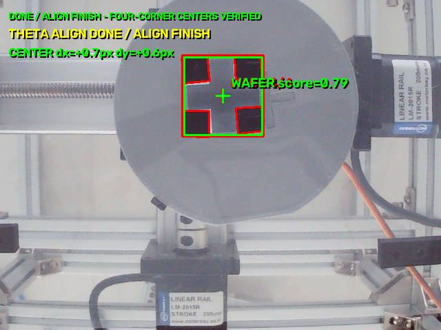

# mask-aligner-vision

비전 기반 **마스크 얼라이너 자동 정렬** 시스템. 카메라로 마스크 키(사각형 4개)와 웨이퍼 키(십자)를 찾아
서브픽셀 단위로 중심을 측정하고, 스텝모터 XY 스테이지를 폐루프로 구동해 두 키를 정렬합니다.

Lab-Linked 캡스톤 디자인 (Team Si-gnal, 2026) - 소프트웨어 파트



## 결과

| 항목 | 결과 |
|---|---|
| 실기기 XY 자동 정렬 (2026-10-02) | 어긋남 **132 px → 0.37 px**, 40초, 모터 명령 14회 |
| 측정 정밀도 (합성 이미지, 정답 좌표 기준) | dx/dy 오차 중간값 **0.456 px → 0.079 px** (5.8배), p95 0.83 → 0.42 px |
| 스테이지 분해능 (실측) | 1 step ≈ 0.005 px, 백래시 < 0.05 px |

## 구조

```
카메라 ─▶ 키 검출 (OpenCV 규칙 기반 / 선택: SAM2, YOLO→SAM2)
        ─▶ 서브픽셀 측정 (subpixel.py: 모서리 직선 피팅, 가림 영역 제외)
        ─▶ dx, dy (px) ─▶ 보정값으로 스텝 변환 (calibration.json)
        ─▶ 시리얼 ─▶ Arduino Mega (firmware/xy_tb6560) ─▶ TB6560 ─▶ X/Y 스테이지
        ◀─ 재촬영, 오차가 기준 안에 들어올 때까지 반복
```

## 주요 구현

- **서브픽셀 측정** (`subpixel.py`): 기존 정수 픽셀 측정(윤곽선 꼭짓점, 템플릿 매칭 최고점)을
  모서리 수직 방향 밝기 기울기의 포물선 보간 → 모서리별 직선 피팅 → 교점으로 바꿈.
  웨이퍼 십자는 팔 양쪽 모서리 직선의 중심선 교점으로 측정하고, 마스크 사각형에 가려진 부분은 제외.
- **안전한 스테이지 펌웨어** (`firmware/xy_tb6560`): 정해진 스텝만 이동, 소프트웨어 이동 한계,
  위치를 EEPROM에 저장 (시리얼 연결 시 Arduino 리셋에도 한계 유지), 가감속.
- **카메라 기반 자동 보정** (`calibrate_xy.py`): 축 매핑, 부호, 스텝/픽셀, 백래시, 기울어짐을 측정.
- **하드웨어 없는 리허설** (`tools/sim_rig.py`): 가상 펌웨어(pty) + 합성 카메라로 보정과 폐루프 정렬 전체를 검증.
- **검출기 비교** (`sam2_keys.py`, `tools/test_detectors.py`): OpenCV / SAM2.1-small / YOLO→SAM2 / OpenCV→SAM2.
  결론: 정밀도는 검출기가 아니라 측정 단계에서 결정됨. 모델은 검출 강건성 용도.

팀 기존 코드(v4 웹 UI, 정렬 상태 머신, 규칙 기반 키 검출)를 기반으로 위 내용을 추가했습니다.

---

# 사용법 (팀원용)

> θ(회전) 모터는 아직 지원하지 않습니다. 항상 `--skip-theta`로 실행하고, 마스크 방향은 손으로 웨이퍼 십자와 맞춥니다.

## 파일

| 파일 | 역할 |
|---|---|
| `mask_aligner_optimized_v4.py` | 웹 앱 (브라우저 화면, START ALIGN 버튼) |
| `subpixel.py` | 키 중심을 소수점 픽셀까지 재는 측정 코드 |
| `calibrate_xy.py` | 카메라로 축 방향, 부호, 스텝/픽셀을 자동 측정 → `calibration.json` |
| `preflight.py` | 시작 전 점검 (포트, 펌웨어, 카메라, 키 인식). 아무것도 움직이지 않음 |
| `calibration.json` | 2026-10-02 측정값. **카메라 위치가 그대로일 때만** 유효 |
| `firmware/xy_tb6560/xy_tb6560.ino` | Arduino Mega 펌웨어 |
| `sam2_keys.py` | SAM2 / YOLO 검출기 (선택, `requirements-optional.txt` 필요) |
| `tools/sim_rig.py` | 장비 없이 연습하는 가상 장비 |
| `tools/bench_precision.py` | 측정 정밀도 벤치마크 (정수 vs 서브픽셀) |
| `tools/test_detectors.py` | 사진/카메라로 검출기 비교 (torch 필요) |
| `tools/flash.sh` | macOS: 펌웨어 백업 + 업로드 |

## 1. 설치 (처음 한 번)

Python 3.11 권장.

**macOS**
```
git clone https://github.com/ricky00-dev/mask-aligner-vision.git
cd mask-aligner-vision
python3.11 -m venv .venv
.venv/bin/pip install -r requirements.txt
```
이후 명령의 `python`은 `.venv/bin/python`으로 실행합니다.

**Windows**
```
git clone https://github.com/ricky00-dev/mask-aligner-vision.git
cd mask-aligner-vision
py -3.11 -m venv .venv
.venv\Scripts\pip install -r requirements.txt
```
이후 명령의 `python`은 `.venv\Scripts\python`으로 실행합니다.

## 2. 펌웨어 (보드에 이미 있으면 생략)

보드에는 `xy_tb6560` 펌웨어가 올라가 있어야 합니다. 확인 방법:
아두이노 IDE 시리얼 모니터 → **9600 baud, 줄 끝 "새 줄(Newline)"** → `PING` 입력 → `PONG`이 오면 정상.

`PONG`이 안 오면 아두이노 IDE로 `firmware/xy_tb6560/xy_tb6560.ino`를 업로드합니다 (보드: Arduino Mega 2560).
macOS에서는 `tools/flash.sh`로 기존 펌웨어 백업과 업로드를 한 번에 할 수 있습니다.

- 팀 원래 수동 제어 코드(F/B/f/b)를 다시 올리면 이 앱은 동작하지 않습니다.
- 수동 제어는 이 펌웨어에서도 됩니다: 시리얼 모니터에서 `F`/`B`(X), `f`/`b`(Y), `S`(정지). 최대 3초, 이동 한계 적용.
- **시리얼 모니터는 다 쓰고 반드시 닫으세요.** 열려 있으면 앱과 스크립트가 아두이노와 통신하지 못합니다.
- 펌웨어 업로드는 **모터 전원(SMPS)을 끈 상태**에서 하는 것을 권장합니다.

## 3. 매번 테스트 순서

1. 모터 전원(SMPS) 켜기, 아두이노 USB와 카메라 연결 (카메라는 USB 허브 말고 노트북에 직접)
2. 점검
   ```
   python preflight.py
   ```
   모두 PASS(또는 WARN)이면 진행. FAIL이면 아래 "문제 해결" 참고.
3. **처음이거나 카메라를 옮겼을 때만** 보정
   ```
   python calibrate_xy.py --zero     # 스테이지를 레일 가운데에 두고 실행: 지금 위치를 0으로
   python calibrate_xy.py            # 축 방향/스텝 측정 → calibration.json, 이동 한계 ±80px 자동 설정
   ```
4. 앱 실행
   ```
   python mask_aligner_optimized_v4.py --camera auto --skip-theta
   ```
   브라우저가 열리면 화면에 **MASK 4/4**와 **WAFER** 박스가 보이는지 확인 → **RESET → START ALIGN**
5. 끝나면 터미널에서 `Ctrl + C`, USB 분리, **모터 전원(SMPS) 끄기** (멈춰 있어도 모터가 뜨거워짐)

포트를 자동으로 못 찾으면 직접 지정합니다.
- `calibrate_xy.py`, `preflight.py`: `--port COM3` (Windows) / `--port /dev/cu.usbmodemXXXX` (macOS)
- 웹 앱: `--arduino-port COM3` (`--port`는 웹 화면 포트 8765라 다른 옵션)

## 4. 안전 수칙 (레일 이탈 방지)

- 펌웨어는 **정해진 스텝만** 움직이고, **이동 한계**를 넘는 명령은 거부합니다 (`ERR X limit`).
- 위치와 한계는 보드 EEPROM에 저장되어 USB를 다시 꽂아도 유지됩니다.
  `calibrate_xy.py`를 돌리면 한계가 화면 ±80px로 설정됩니다. 직접 바꾸려면 `python calibrate_xy.py --limit <스텝>`.
- 레일 이동 거리는 200 mm (LM-2015R). 1스텝 ≈ 0.005px.
- 처음 움직일 때는 장비 옆에서 전원을 바로 끌 수 있게 지켜보세요. 비상 시 웹 화면 **STOP** 또는 USB 분리.
- 모터가 **움직이는 중**에 USB를 빼면 저장된 위치가 실제와 어긋납니다. 그때는 스테이지를 가운데에 두고 `calibrate_xy.py --zero`.
- 정렬 거리가 길면(화면 80px 이상) 한계에 걸려 멈춥니다. 웨이퍼를 마스크 근처에 두고 시작하세요.

## 5. 문제 해결

| 증상 | 원인 / 조치 |
|---|---|
| `no PONG` / `did not answer PING` | ① 시리얼 모니터, 웹 앱 등 포트를 쓰는 프로그램 닫기 ② 포트 직접 지정 `--port` ③ 펌웨어 확인 (2번) |
| `serial open` 실패 | 다른 프로그램이 포트를 잡고 있음 |
| 모터가 안 움직임 (`DONE`은 옴) | **모터 전원(SMPS) 확인** |
| `camera with keys` FAIL / 화면에 키 없음 | 마스크 사각형 4개가 다 화면 안에 있는지, 손이 가리지 않는지, 초점/조명 |
| START 후 5초 뒤 `Camera/key unavailable` | 키가 안 보이는 상태에서 START를 누름. 키가 보일 때 다시 |
| 정렬 중 `ERR X limit` / `ERR Y limit` | 이동 한계 도달. 웨이퍼를 마스크 가까이 두고 다시 |
| 브라우저 화면이 멈춤 | 앱을 다시 켰으면 예전 탭은 끊김 → 새로고침 |
| 마스크 키가 화면 가장자리 (MASK 3/4) | 마스크나 카메라를 옮겨 사각형 4개가 다 보이게. 카메라를 옮겼으면 보정 다시 |

## 6. 현재 한계

- θ 미지원: 마스크 방향은 손으로 맞춤 (화면의 theta 값이 0° 근처면 OK)
- 키가 겹치면 측정이 ±0.5px 정도 흔들려 완료 직전에 몇 번 더 보정함 (개선 예정)
- 결과는 px 단위. mm/µm 환산은 카메라 캘리브레이션 후 가능 (추정 1px ≈ 0.31~0.47 mm)

## 장비 없이 연습

```
python tools/sim_rig.py
```
가상 아두이노 + 가상 카메라로 보정과 자동 정렬 전체 과정을 돌려봅니다. 실제 장비는 움직이지 않습니다.

## 작업 규칙

- `main`에는 **실기기에서 검증된 코드만** 둡니다.
- 새 기능은 브랜치(`feature/z-theta`, `feature/1080p` 등)에서 작업하고, Pull Request로 합칩니다.
- PR에는 무엇을 바꿨는지와 **어떻게 확인했는지**(시뮬레이터, 실기기 결과)를 적어주세요.
- `out/`(카메라 사진), 가상환경, 데이터셋, 가중치, `.hex`는 올리지 않습니다 (`.gitignore`에 등록됨).
