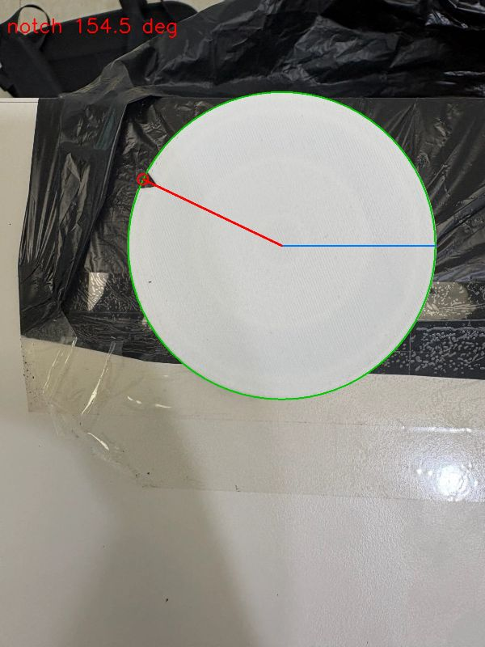

# 노치 각도 측정 (프리얼라인)

`notch.py`는 사진 한 장에서 웨이퍼 노치(세모 홈)의 방향을 잽니다. 학습한 모델이나 기준 그림 없이, 기하 계산만으로 측정합니다.



초록 = 찾은 원판, 파랑 = 0° 기준(오른쪽), 빨강 = 노치 방향.

## 동작

1. Hough 원 검출로 원판의 중심과 반지름을 찾는다.
2. 원 안쪽 가장자리(반지름의 93~97%)를 0.5° 간격으로 한 바퀴 돌며 밝기를 잰다.
3. 원판보다 확실히 어두운(60% 미만) 가장 긴 연속 구간을 노치로 보고, 그 가운데 각도를 돌려준다.

- 각도 규약: 0° = 영상 오른쪽, 반시계 방향(+), 0~360°.
- **프리얼라인 목표: 노치를 항상 정 오른쪽(0°)에 둔다.** (`TARGET_DEG`, 팀 결정 2026-11-18)
- `rotation_to(target, current)`는 가까운 쪽으로 도는 회전량을 돌려준다(-180~+180°, 반시계 +).

## 실행

```bash
python notch.py 사진.jpg --out 확인.jpg
# 노치 154.5° · 폭 3.5° · 대비 0.66 · 중심 (872, 759) · 반지름 476px
# 목표 0.0° 까지 회전 -154.5° (반시계 +)
```

```python
from notch import measure_notch, rotation_to
n = measure_notch(frame)          # 못 찾으면 None
turn = rotation_to(0, n.angle_deg)
```

## 조건과 한계

- 원판이 배경보다 밝아야 한다(흰 원판 + 어두운 배경). 원판 가장자리가 흰 바닥에 닿아 있으면 그 구간을 노치로 착각할 수 있다. 이송부 아래를 검은색으로 덮는다.
- 원판 전체가 화면에 들어와야 한다.
- 어두운 구간이 30°보다 넓으면 원 검출 실패로 보고 None을 돌려준다.
- 시험: `pytest tests/test_notch.py`. 합성 원판 8가지 각도와 실제 사진 1장으로 확인했다(오차 1.5° 이내).
- θ 서보는 연속회전형이라 각도 명령이 없다. 회전량은 `PT <id> <방향> <ms>`의 시간으로 바꿔야 하고, 회전 속도(°/초)를 먼저 재야 한다.
